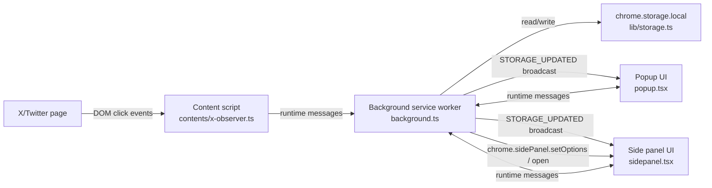
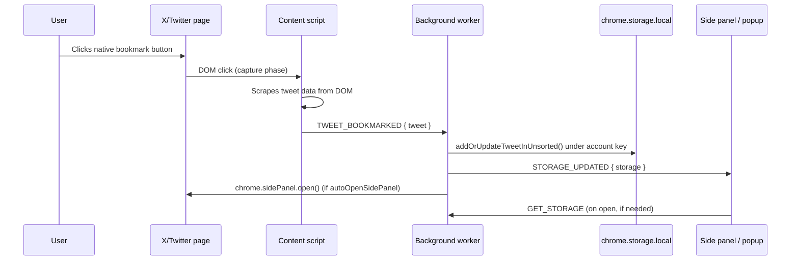

# Navipost — Architecture & System Design

This document describes how Navipost works internally: its components, runtime lifecycle, data flow, and design constraints.

For product information, installation, building, and publishing, see the [README](README.md).
For the full storage schema and account handling, see [overview/storage.md](overview/storage.md).
For the extension message protocol, see [overview/messaging.md](overview/messaging.md).

## System summary

Navipost is a Chrome MV3 browser extension built with [Plasmo](https://docs.plasmo.com/). It runs entirely in the browser with no backend:

- A **content script** observes bookmark/unbookmark clicks on X/Twitter and scrapes tweet data from the page DOM.
- A **background service worker** is the single point of truth for all storage mutations and side-panel control.
- A **popup** (320px) and a **side panel** provide the user-facing management UI.
- All state lives in `chrome.storage.local`, namespaced per X/Twitter account handle.

Key technologies: Plasmo 0.90.x, React 18, TypeScript, Tailwind CSS, `chrome.runtime` / `chrome.tabs` / `chrome.storage` / `chrome.sidePanel` APIs.

## Architecture diagram

The content script never touches storage directly; every mutation goes through the background service worker. UI surfaces also never write to storage themselves — they send messages to the background and react to `STORAGE_UPDATED` broadcasts.

## Runtime components

### Content script — `contents/x-observer.ts`

- Injected on `https://x.com/*` and `https://twitter.com/*` (declared via `PlasmoCSConfig`).
- Registers a capture-phase `document` click listener; on each click it checks whether the target is (or is inside) `[data-testid="bookmark"]` or `[data-testid="removeBookmark"]`.
- On a bookmark click, scrapes the enclosing `[data-testid="tweet"]` node for: tweet ID (from the first `/status/<id>` link), author handle, text, URL, and a `savedAt` Unix timestamp, then sends `TWEET_BOOKMARKED` to the background.
- On an unbookmark click, sends `TWEET_UNBOOKMARKED` with the tweet ID.
- Detects the logged-in account handle (from the side-nav account switcher or profile link) and reports it via `OBSERVER_READY`; re-checks every 3 seconds to catch account switches, and reports `ready: false` on `pagehide`.
- Holds **no state and performs no storage writes**.

### Background service worker — `background.ts`

- Central **message router**: the only component that calls `lib/storage.ts` mutation functions (see [overview/messaging.md](overview/messaging.md) for the full contract).
- Maintains an in-memory `observerStateByTab` map (`tabId → { ready, handle? }`) used to resolve which account's storage namespace applies to a given request.
- **Side-panel control**: enables/disables `sidepanel.html` per tab based on the URL (only on X/Twitter domains), and auto-opens it on bookmark when the `autoOpenSidePanel` setting is on.
- Broadcasts `STORAGE_UPDATED` with the full normalized storage after each mutation so UIs stay in sync.

### Popup — `popup.tsx`

- Compact status surface: shows folder/tweet counts, whether the current tab is on X/Twitter, whether the content observer is ready, and the detected handle.
- Single action: **Open Side Panel** (calls `chrome.sidePanel.open()` for the active tab).
- The service worker itself is ephemeral: MV3 may suspend it at any time, and the in-memory observer state map is lost (see [Limitations](#limitations)).
### Side panel — `sidepanel.tsx`

- The primary management UI: folder list with expand/collapse, search across saved posts, folder creation/deletion, moving tweets between folders, opening tweet URLs, theme toggle, and the auto-open toggle.
- Subscribes to `STORAGE_UPDATED` and re-reads storage via `GET_STORAGE` to refresh its state.

### Storage layer — `lib/storage.ts`

- All reads/writes go through `chrome.storage.local`, keyed by `buildStorageKey(handle)` (see [overview/storage.md](overview/storage.md)).
- Every read and write passes through a **normalization step** (`buildStorage`) that repairs or rejects malformed data — details in [overview/storage.md](overview/storage.md#data-normalization-and-invariants).
- `lib/messaging.ts` wraps `chrome.runtime.sendMessage` with try/catch so a closed receiver (e.g. service worker asleep) never throws into the content script.

## Runtime lifecycle

- `runtime.onInstalled` — initializes default storage, syncs the side panel for the active tab.
- `runtime.onStartup` — syncs the side panel for the active tab.
- `tabs.onActivated` / `tabs.onUpdated` / `windows.onFocusChanged` — re-evaluate side-panel enablement for the affected tab and clear observer state for non-X/Twitter tabs.
- `tabs.onRemoved` — drops the tab's observer state.
- The service worker itself is ephemeral: MV3 may suspend it at any time, and the in-memory observer state map is lost (see [Limitations](#limitations)).

## Bookmark event flow

Unbookmarking mirrors this: `TWEET_UNBOOKMARKED { tweetId }` → `removeTweetEverywhere()` → `STORAGE_UPDATED`. Folder operations from the side panel follow the same message → mutate → broadcast pattern.

## Runtime state vs. persisted state

| Kind | Data | Where |
| --- | --- | --- |
| Persisted | Folders, tweets, settings | `chrome.storage.local` under per-account keys |
| Runtime only | Observer readiness per tab, current account handle per tab, side-panel enablement | In-memory maps in the background worker |

Because observer state is runtime-only, account detection must re-occur after every service-worker restart or page navigation. UI code must always handle the "no handle detected" fallback key (see [overview/storage.md](overview/storage.md#per-account-isolation)).

## Permissions and security boundaries

Declared in `package.json` → `manifest`:

- `storage` — local persistence via `chrome.storage.local`.
- `tabs` — read active-tab URLs to decide side-panel availability.
- `sidePanel` — enable/open the side panel per tab.
- Host permissions `https://x.com/*`, `https://twitter.com/*` — allow the content script to run on X/Twitter pages.

The extension performs no network requests of its own and talks to no servers. All privilege is used locally: observing clicks on X/Twitter pages and persisting scraped data.

## Limitations

- **DOM selector fragility** — scraping depends on X/Twitter `data-testid` attributes (`tweet`, `tweetText`, `User-Name`, `bookmark`, `removeBookmark`, `SideNav_AccountSwitcher_Button`, `AppTabBar_Profile_Link`). If X changes its markup, capture and account detection silently stop working.
- **Account detection is best-effort** — when the handle can't be detected, data falls back to the shared `navipost` namespace (see [overview/storage.md](overview/storage.md#per-account-isolation)).
- **Ephemeral service worker state** — observer/tab state is lost on suspension; behavior recovers on the next `OBSERVER_READY` or tab event.
- **Side-panel API surface** — `chrome.sidePanel.open()` requires Chrome 114+ and can fail outside valid user-gesture contexts; the background swallows these errors.
- **`folderDeleteBehavior` is not yet exposed in the UI** — the setting is modeled and honored by the storage layer (default `move_to_unsorted`), but there is currently no UI or message to change it.
- **No automated tests** — verification is manual (checklist in the [README](README.md#manual-verification-checklist)).
- **Local-only data** — no export/import, no sync; clearing browser data loses saved posts.

## Source map

| File | Role |
| --- | --- |
| [background.ts](background.ts) | Message router, side-panel control, observer state |
| [contents/x-observer.ts](contents/x-observer.ts) | Content script: click observation, tweet scraping, account detection |
| [lib/storage.ts](lib/storage.ts) | Storage layer: normalization, mutation helpers |
| [lib/messaging.ts](lib/messaging.ts) | Safe `runtime.sendMessage` wrapper |
| [types/navipost.ts](types/navipost.ts) | Types, message union, defaults |
| [popup.tsx](popup.tsx) | Popup UI |
| [sidepanel.tsx](sidepanel.tsx) | Side panel UI |
| [components/Icon.tsx](components/Icon.tsx) / [utils/icon.ts](utils/icon.ts) | Inline SVG icons |

